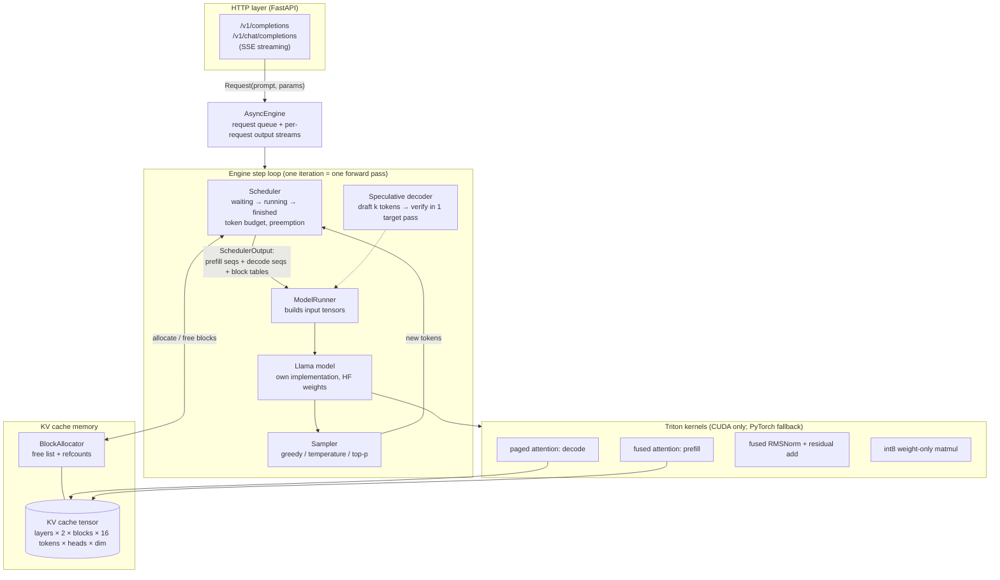

# Nimbus build plan

Planning document: what gets built, how the pieces fit, the data structures, the milestones and how each claim will be measured. No code exists yet. The checklist at the bottom is the source of truth for where we are.

## Goal in one paragraph

Nimbus is a small LLM inference engine in the style of vLLM. It serves many chat requests on one GPU at once by (1) storing each request's attention memory (the KV cache) in fixed-size pages instead of one big reserved block, (2) re-forming the batch at every generated token, so finished requests leave and new ones join right away, (3) using custom fused GPU kernels written in Triton, (4) speculative decoding, where a tiny model guesses several tokens and the big model checks them in one pass, and (5) INT8 weights to halve memory. An OpenAI-compatible HTTP server sits on top. Every speed claim is measured against HuggingFace `generate()`.

## Environment (checked 2026-10-07)

| | |
|---|---|
| GPU | RTX 4050 Laptop, 6 GB (6141 MiB), compute capability 8.9 (Ada), driver 610.88 |
| Dev OS | **WSL Ubuntu**, which sees the GPU via `nvidia-smi`. Official Triton wheels are Linux-only, so all GPU work happens there. |
| WSL | Python 3.10.12 (will use `uv` to get 3.11), 22 cores, 15 GB RAM, 950 GB free |
| Windows | Python 3.12.6, no torch installed. Not used for nimbus. |
| **Installed (M0)** | venv `~/venvs/nimbus` in WSL (Python 3.11): torch 2.11.0+cu128, triton 3.6.0, transformers 5.19.0, tokenizers 0.23.2. Models in the WSL HF cache (2.7 GB). |
| **Measured (M0)** | 4.80 of 6.00 GiB free on the GPU (Windows display holds the rest). A Triton toy kernel compiles in 1.4 s and is correct. HF fp16 greedy on TinyLlama peaks at 2.06 GiB. llama-160m and llama-68m have identical vocab and token IDs to TinyLlama. |
| **transformers 5 notes** | `apply_chat_template(..., return_dict=True)["input_ids"]`; RoPE theta lives in `config.rope_parameters["rope_theta"]` (10000.0 for TinyLlama) |
| Big-GPU runs | `bench/modal_a100.py` (Modal) and `bench/colab_a100.ipynb` for Llama-3-8B on an A100. Written here, run by the user. |

## Models

| Role | Model | Size (fp16) | Why |
|---|---|---|---|
| Main (target) | `TinyLlama/TinyLlama-1.1B-Chat-v1.0` | 2.2 GB | Standard Llama architecture (RoPE, RMSNorm, SwiGLU, grouped-query attention), so the same code runs Llama-3-8B on the A100 |
| Draft (speculative) | `JackFram/llama-160m` (first choice) or `llama-68m` | 0.3 / 0.14 GB | Uses the same 32K Llama tokenizer as TinyLlama, which speculative decoding requires. Vocab compatibility is checked in M5 before relying on it. |
| Fallback pair | `gpt2-xl` target + `gpt2` draft | 3.1 + 0.25 GB | Well-known pairing if the Llama draft's acceptance rate is poor |
| A100 runs | `meta-llama/Meta-Llama-3-8B-Instruct` (+ `Llama-3.2-1B` draft) | 16 GB | The spec's full-size benchmark. Needs the user's HuggingFace access to Llama 3. |

**GPU memory budget on the 6 GB card** (TinyLlama: 22 layers, 4 KV heads, head dim 64):
- weights about 2.2 GB fp16 or about 1.1 GB int8
- KV cache per token = 22 layers × 2 (K,V) × 4 heads × 64 × 2 bytes = **22.5 KB**
- giving the cache about 2.5 GB leaves room for about 110K tokens, or about 7,000 blocks of 16 tokens, plus activations and CUDA overhead. The real number is measured at startup by profiling peak memory on a dummy batch, like vLLM does.

## Architecture



### How one request flows

1. `POST /v1/chat/completions` → the prompt is tokenized into a `Request`, and the `AsyncEngine` queues it.
2. At the next engine step, the **scheduler** admits it if enough free KV blocks exist. Its prompt is **prefilled**: one forward pass over all prompt tokens, which writes their K/V into freshly allocated blocks.
3. On every later step, it's part of the **decode batch**: one new token per running request per step, regardless of when each request arrived (continuous batching).
4. Every 16 tokens, the allocator hands the sequence one more block. When the request finishes, all its blocks go back to the free list immediately, so the next waiting request can start.
5. If memory runs out mid-generation, the newest running request is **preempted**: its blocks are freed and it goes back to waiting, then recomputes its prompt and output-so-far later.
6. Generated tokens stream back to the HTTP client as SSE events.

## Data structures ("schema")

```python
@dataclass
class SamplingParams:
    max_tokens: int = 128
    temperature: float = 0.0          # 0 = greedy
    top_p: float = 1.0
    stop: list[str] = []
    seed: int | None = None

class SeqStatus(Enum):
    WAITING; RUNNING; PREEMPTED; FINISHED_STOPPED; FINISHED_LENGTH; FINISHED_ABORTED

@dataclass
class Sequence:
    seq_id: int
    prompt_ids: list[int]
    output_ids: list[int]
    params: SamplingParams
    status: SeqStatus
    block_table: list[int]            # logical block i → physical block id
    num_computed: int                 # tokens whose K/V are already in the cache
    arrival_time: float
    first_token_time: float | None    # for time-to-first-token
    # len = len(prompt_ids) + len(output_ids); blocks needed = ceil(len / BLOCK_SIZE)

class BlockAllocator:
    num_blocks: int
    free: deque[int]                  # O(1) alloc and free
    refcount: np.ndarray[int32]       # >1 when blocks are shared (spec-decode rollback, prefix reuse)
    def allocate(self) -> int
    def free_block(self, b: int) -> None
    def can_allocate(self, n: int) -> bool
    # invariant: every block is either in `free` or has refcount ≥ 1, never both

@dataclass
class SchedulerOutput:
    prefill: list[Sequence]           # prompts processed this step (chunked if over the token budget)
    decode: list[Sequence]            # one new token each
    preempted: list[Sequence]
    num_batched_tokens: int           # ≤ max_num_batched_tokens (e.g. 2048)

# KV cache: one tensor per layer, preallocated once at startup
#   k_cache, v_cache: [num_blocks, BLOCK_SIZE=16, num_kv_heads, head_dim]   (fp16)
# ModelRunner input for one step (flattened, no padding):
#   input_ids [T], positions [T]
#   slot_mapping [T]          where token t's K/V gets written = block * 16 + offset
#   block_tables [B, max_blocks]   (decode attention reads through these)
#   seq_lens [B], query_start_loc [B+1]   (where each prefill sequence starts in the flat batch)
```

**Why pages?** HF `generate()` reserves contiguous memory for the longest possible output per request and pads every request in a batch to the same length. Paging lets requests grow 16 tokens at a time and wastes at most 15 slots per request. That's where the extra concurrency, and so the throughput, comes from.

## Package layout

| Path | Role |
|---|---|
| `nimbus/config.py` | `EngineConfig`, model config parsed from HF `config.json` |
| `nimbus/model/llama.py` | Llama forward (RoPE, GQA, SwiGLU, RMSNorm); loads HF safetensors |
| `nimbus/model/weights.py` | safetensors loading, int8 conversion |
| `nimbus/cache/block_allocator.py`, `cache/kv_cache.py` | allocator, cache tensors, memory profiling |
| `nimbus/scheduler.py` | continuous batching, prefill/decode split, chunked prefill, preemption |
| `nimbus/runner.py` | builds flat batch tensors, runs the model, CUDA graph capture for decode (stretch) |
| `nimbus/sampler.py` | greedy, temperature, top-p, seeded |
| `nimbus/engine.py`, `async_engine.py` | step loop; asyncio wrapper with per-request streams |
| `nimbus/spec/` | draft model runner, verification, rejection sampling, KV rollback |
| `nimbus/quant/int8.py` | per-output-channel symmetric int8 weights |
| `nimbus/kernels/` | Triton: `paged_attention.py`, `prefill_attention.py`, `rmsnorm.py`, `int8_matmul.py`; `reference.py` (PyTorch versions used as fallback and as test oracles) |
| `nimbus/server/` | FastAPI app, OpenAI request/response schemas (pydantic) |
| `bench/` | `throughput.py`, `latency.py`, `speculative.py`, `quant_ppl.py`, `hf_baseline.py`, `modal_a100.py`, `colab_a100.ipynb` |
| `tests/` | pytest: kernels vs reference, allocator, scheduler, end-to-end vs HF greedy |

## Correctness strategy

1. **End-to-end oracle.** With greedy sampling, Nimbus output must match HF `generate()` token for token on a fixed prompt set. Small fp16 differences can flip a near-tie, so allow at most 1 divergent prompt in 50 and report it.
2. **Kernels.** Each Triton kernel is compared to `kernels/reference.py` across shapes, including odd lengths and partial last blocks (`torch.allclose`, fp16 tolerances such as atol 1e-2 for attention), and benchmarked against it.
3. **Allocator and scheduler.** Property tests check that no block leaks, no block is double-owned, the free count is restored after every request finishes, preemption frees everything, and the token budget is never exceeded.
4. **Speculative decoding.** With greedy sampling, output must equal plain target-model output exactly. Rejection sampling has a statistical test: the token distribution matches the target's.
5. **No CUDA.** Every test runs on CPU through the PyTorch fallbacks, and Triton tests are skipped. CI runs on CPU only, because GitHub runners have no GPU.

## Benchmark plan (only measured numbers go in RESULTS.md)

| Claim | Method | Spec target |
|---|---|---|
| Throughput vs HF | N concurrent requests (N = 8, 32, 64) with ShareGPT-like synthetic prompt/output lengths. HF baseline = `generate()` on static padded batches of the same requests. Report output tokens/s, plus HF's best batch size. | 3.1x |
| Decode latency | ms per output token at batch 1 and batch 16, Nimbus vs HF, with time-to-first-token reported separately | −28% |
| Speculative decoding | k = 2, 4, 6 draft tokens: acceptance rate and end-to-end speedup vs non-speculative Nimbus at batch 1 | 2.2x at 74% acceptance |
| INT8 quality | WikiText-2 test perplexity (stride 512, context 2048) for FP16 vs INT8 | < 1% loss |
| INT8 memory | weight bytes and peak `torch.cuda.max_memory_allocated` | about 50% |
| Kernels | Triton vs PyTorch reference: µs per call across shapes | (no target) |

Every benchmark records GPU, driver, torch/triton versions, command and raw JSON. The A100 scripts run the same benchmarks with Llama-3-8B.

## Milestones

- [x] **M0 Setup:** WSL env with `uv`, torch + CUDA, triton, transformers, a repo skeleton, CPU CI. Download TinyLlama and the draft model.
- [x] **M1 Reference model:** own Llama forward with a plain contiguous KV cache, matching HF greedy output.
- [ ] **M2 Paged KV cache:** block allocator, cache tensors, slot mapping, paged decode attention in PyTorch. Still matches HF.
- [ ] **M3 Continuous batching:** scheduler, prefill/decode split, chunked prefill, preemption, engine loop, sampler.
- [ ] **M4 Triton kernels:** paged decode attention, prefill attention, fused RMSNorm+residual, with correctness tests and micro-benchmarks.
- [ ] **M5 Speculative decoding:** draft runner, verification, rejection sampling, KV rollback; acceptance and speedup measured.
- [ ] **M6 INT8 weight-only:** quantizer plus Triton int8 matmul; perplexity and memory measured.
- [ ] **M7 Server:** OpenAI-compatible FastAPI with streaming, async engine; tested with the `openai` Python client.
- [ ] **M8 Benchmarks:** all of the above vs HF; RESULTS.md; Modal + Colab A100 scripts.
- [ ] **M9 Docs and ship:** README (Mermaid, quickstart, benchmark table, design decisions), INTERVIEW_NOTES.md, CI green, PR merged.

## Risks and how they're handled

| Risk | Plan |
|---|---|
| 6 GB VRAM is tight | TinyLlama fp16 (2.2 GB) leaves about 3 GB; the KV budget is set from measured free memory; int8 frees another 1.1 GB |
| Triton under WSL | Check `triton` imports and a toy kernel compiles in M0 before building on it; the fallback is PyTorch SDPA plus `torch.compile` |
| HF baseline too weak or unfair | Give HF its best case: tune the batch size and use SDPA attention. Report what HF was given. |
| Speculative speedup is small at 1.1B | The spec's 2.2x assumes a big target. A 1.1B target is cheap, so the gain may be much smaller here. Report it honestly; the A100 script measures the 8B case. |
| Laptop GPU clocks vary (thermals) | 3 reps per benchmark with median and min–max, as in Strata |
| Llama-3 is gated on HF | A100 scripts take an `HF_TOKEN`; the user has to accept the license |

## Not doing (scope)

Tensor parallelism and multi-GPU, beam search, LoRA, prefix caching beyond what refcounts allow for free, and an FP8 KV cache.
