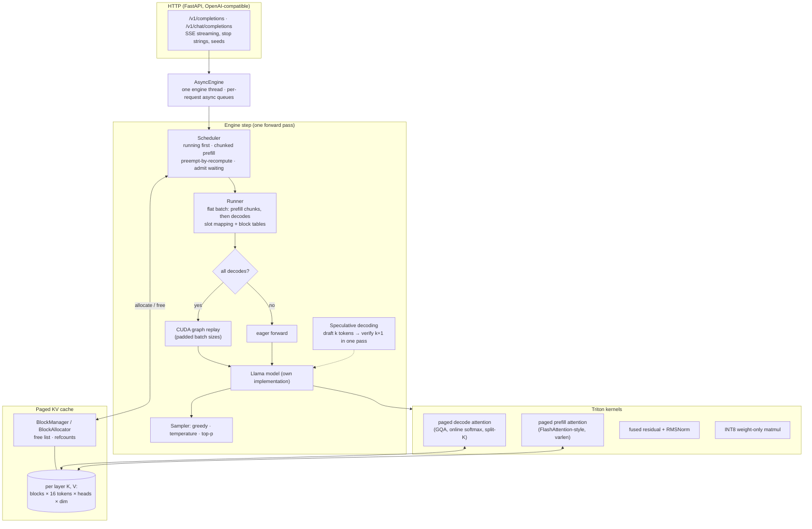

# Nimbus

Nimbus is a small LLM inference engine in the style of vLLM, written from scratch on PyTorch and Triton. It serves many requests at once on one GPU by storing each request's attention memory (the KV cache) in 16-token pages instead of one big preallocated block, and by rebuilding the batch on every generated token so finished requests leave and new ones join immediately (continuous batching). Custom Triton kernels handle paged attention and fused RMSNorm, decode steps run as CUDA graphs, a small draft model can propose tokens for the large one to verify (speculative decoding), and INT8 weight-only quantization roughly halves weight memory. An OpenAI-compatible HTTP server sits on top. Everything was developed and measured on a 6 GB RTX 4050 laptop GPU with TinyLlama-1.1B-Chat. Every speedup below is measured against HuggingFace `generate()`; the scripts run Llama-3-8B on an A100 as well.

## Architecture



| Path | Role |
|---|---|
| `nimbus/model/` | Llama forward (fused qkv/gate-up, RoPE incl. Llama 3.1 scaling), HF safetensors loader |
| `nimbus/cache/` | block allocator, per-sequence block tables, KV cache tensors |
| `nimbus/scheduler.py`, `runner.py`, `engine.py` | continuous batching, batch flattening, step loop, memory profiling |
| `nimbus/cuda_graph.py` | decode CUDA graphs |
| `nimbus/kernels/` | Triton kernels + PyTorch references (CPU fallback and test oracles) |
| `nimbus/spec/` | speculative decoding (draft/verify, rejection sampling, verify graphs) |
| `nimbus/quant/` | INT8 weight-only quantization |
| `nimbus/server/`, `async_engine.py` | OpenAI-compatible server |
| `bench/` | benchmarks, `run_all.sh`, Modal + Colab A100 runners |

## Quickstart

Needs Linux (or WSL) with an NVIDIA GPU for the Triton path; everything also runs on CPU with PyTorch fallbacks.

```bash
pip install torch --index-url https://download.pytorch.org/whl/cu128
pip install -e ".[dev]"
pytest -q                                   # 69 tests; GPU tests skip without CUDA

# Offline generation
python - <<'PY'
from nimbus.config import EngineConfig
from nimbus.engine import LLMEngine
from nimbus.sequence import SamplingParams
eng = LLMEngine(EngineConfig(max_model_len=1024))          # TinyLlama by default
out = eng.generate(["The capital of France is"], SamplingParams(max_tokens=16))
print(eng.tokenizer.decode(out[0]))
PY

# OpenAI-compatible server
python -m nimbus.server --port 8000 [--quantization int8]
curl localhost:8000/v1/chat/completions -H 'content-type: application/json' \
  -d '{"messages":[{"role":"user","content":"Hi!"}],"max_tokens":32,"stream":true}'

# Benchmarks (writes results/*.json; about an hour on a laptop GPU)
bash bench/run_all.sh
modal run bench/modal_a100.py               # Llama-3-8B on an A100 (needs Modal + HF token)
```

## Benchmarks

RTX 4050 Laptop GPU (6 GB), WSL2, TinyLlama-1.1B-Chat fp16, medians of 3 runs. Full method, raw JSON and per-run numbers: [RESULTS.md](RESULTS.md).

| Metric | Target | Measured | |
|---|---|---|---|
| Throughput vs HF `generate()` | 3.1× | 9.2× on ShareGPT-like mixed lengths (1,109 vs 121 tok/s, 64 requests); 1.6× on equal lengths, HF's best case (2,212 vs 1,370) | hit (mixed) / miss (equal) |
| Decode latency per token vs HF | −28% | −55% at batch 1 (38.0 → 17.0 ms); −73% with INT8 (10.2 ms) | hit |
| Speculative decoding speedup / acceptance | 2.2× at 74% | 1.29× at 17% (llama-68m draft, k=4) | miss |
| INT8 perplexity loss (WikiText-2) | < 1% | +0.05% (7.0952 → 7.0989) | hit |
| INT8 weight memory | ~50% | 56% (2.05 → 1.15 GiB) | hit |

## Design decisions & tradeoffs

**Pages instead of contiguous caches.** HF reserves each request's cache as one tensor and pads a batch to its longest member. Nimbus hands out 16-token blocks as requests grow, wasting at most 15 slots per request, and frees them the instant a request finishes. The cost is indirection: attention must read keys through a block table, which is why it needs custom kernels. Block size 16 balances waste (bigger blocks waste more) against kernel efficiency (smaller blocks mean more table lookups).

**Rebuild the batch every step.** Continuous batching admits new work whenever a slot frees up, instead of waiting for the slowest request in a static batch. Running requests are always scheduled before waiting ones, so in-flight work is never starved. Long prompts are processed in chunks under a per-step token budget so a single long prompt can't freeze every decode.

**Preempt by recomputation, not swapping.** When the cache is full, the newest request gives up all its blocks and later recomputes its prompt plus output. Swapping blocks to CPU memory would save the recompute but needs a second memory pool and copy streams; for chat-length sequences recomputing is cheap and much simpler. A small block reserve on admission keeps preemption rare.

**Profile before you optimize.** The engine first ran at 63 tok/s because PyTorch's allocator fragmented past the 6 GB card and WSL silently paged GPU memory to system RAM; per-step memory logging found it, and expandable segments plus a hard memory cap fixed it. Profiling then showed decode was CPU-bound (32 ms of Python kernel launches for 15 ms of GPU work), which is why CUDA graphs mattered more than any kernel: 1,777 → ~2,600 tok/s in the exploratory probe.

**CUDA graphs for decode only.** Decode steps have a predictable shape, so they are captured once per padded batch size and replayed with one call. Prefill steps vary too much in shape and are compute-heavy anyway, so they run eagerly. Padding rows write into a scratch block no request owns, and the decode kernel's grid is fixed per batch size so the graph never needs the current context length.

**Kernels shaped for grouped-query attention.** The decode kernel processes all 8 query heads that share a KV head together, turning a matrix-vector product into a small matrix multiply on tensor cores and reading each key once instead of 8 times. For long contexts with few sequences it splits the context across programs and merges the partial softmaxes, so batch-1 decoding still fills the GPU.

**Exactness first.** The model follows HuggingFace's operation order (RMSNorm and RoPE in float32, the rest in fp16), so greedy output matches HF token for token on all 8 test prompts. Every kernel has a PyTorch reference that doubles as the CPU fallback and as its test oracle, and every scheduler optimization is tested by checking outputs are identical to solo runs.

**Weight-only INT8.** Decode is limited by reading weights, so storing them in half the bytes speeds decode up without touching activations — no calibration data, no outlier handling. Per-output-channel scales factor out of the matmul and are applied once at the end of the kernel. Embeddings and the output head stay fp16 for quality.

**Speculative decoding: honest about the regime.** It only pays when the target is expensive per step and the draft agrees with it often. On this laptop TinyLlama is already fast and the available drafts are small base models that agree with a chat model only 12–36% of the time, so the gain is small or negative; the code is built to show the real effect on Llama-3-8B with Llama-3.2-1B on an A100, which is where the 2.2× target comes from.
